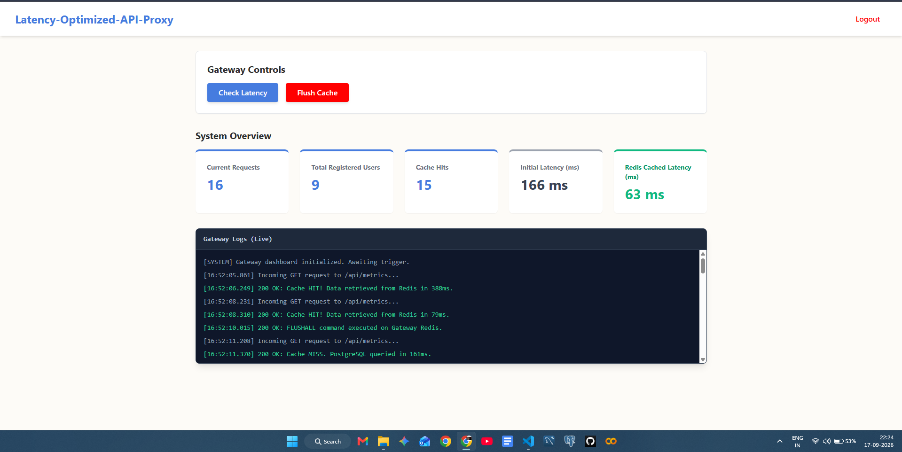

# Cloud-Native Performance Dashboard (Frontend)

A lightning-fast, responsive user interface built with React, TypeScript, Vite, and Tailwind CSS. It serves as the control center for the Latency-Optimized API Proxy, securely authenticating users and visualizing real-time cache telemetry, hit/miss ratios, and system latency.



---

### Prerequisites
Make sure you have Node.js and npm installed. To view live metrics, ensure the Gateway and Backend services are running locally on your machine.

## Getting Started

### Installation

1. Clone the repository:
    ```bash
    git clone https://github.com/SaharshBhatnagar/Latency-Optimized-API-Proxy-frontend.git
    ```

2. Navigate to the project directory:
    ```bash
    cd Latency-Optimized-API-Proxy-frontend
    ```

3. Install dependencies:
    ```bash
    npm install
    ```

4. Create your environment file:
    Create a .env file in the root and add your API gateway target:
    ```bash
    VITE_API_URL=http://localhost:8000/api
    ```

    > **Note**: Vite requires environment variables exposed to the client to be prefixed with `VITE_`. In your production AWS environment, this points to your live gateway URL (`https://api.saharshbhatnagar.app/api`).

5. Start the development server:
    ```bash
    npm run dev
    ```

## Usage

### Production Build

1. Compile the TypeScript and build the React app:
    ```bash
    npm run build
    ```

2. Preview the compiled production build locally:
    ```bash
    npm run preview
    ```

## Docker Deployment

> This frontend is containerized using a multi-stage Dockerfile that builds the Vite application and serves the static assets via a high-performance Nginx web server.

The application can be run as a container by mapping the standard HTTP port:

```bash
docker build -t latency-optimized-api-proxy-frontend .
docker run -p 3000:80 latency-optimized-api-proxy-frontend
```

If you are running the full stack locally, use docker-compose:

```bash
docker compose up -d frontend
```

## Directory Structure

```plaintext
Latency-Optimized-API-Proxy-frontend/
├── .github/workflows/deploy.yml
├── src/
│   ├── components/          
│   │   ├── AccessDeniedModal.tsx
│   │   ├── Dashboard.tsx    
│   │   ├── LoginForm.tsx    
│   │   ├── Navbar.tsx
│   │   └── ResetPasswordModal.tsx
│   ├── services/            
│   │   └── authService.ts   
│   ├── App.tsx              
│   ├── index.css            
│   └── main.tsx             
├── Dockerfile               
├── nginx.conf               
├── package.json             
├── tailwind.config.js       
├── tsconfig.json            
└── vite.config.ts           
```

## CI/CD Pipeline

> This repository includes a GitHub Actions workflow (`deploy.yml`) that automatically builds the Docker image, pushes it to Amazon Elastic Container Registry (ECR), and automatically deploys to your EC2 instance via SSH upon pushes to the main branch. Ensure your AWS IAM credentials and EC2 SSH secrets are stored safely in GitHub Repository Secrets.

## Additional Documentation

**Architecture Details**

> The production Docker image utilizes Nginx (`nginx.conf`) to serve the compiled static assets, ensuring optimal load times and proper routing for single-page application (SPA) client-side navigation.

**Tech Stack**: React, TypeScript, Vite, Tailwind CSS, Nginx, Docker, AWS (ECR, EC2)

### Full Architecture Stack

This frontend UI is one component of a complete cloud-native ecosystem. You can explore the other microservices in this architecture here:

* **API Gateway:** [Latency-Optimized API Proxy Gateway](https://github.com/SaharshBhatnagar/Latency-Optimized-API-Proxy-gateway)

* **Backend:** [Latency-Optimized API Proxy Backend](https://github.com/SaharshBhatnagar/Latency-Optimized-API-Proxy-backend)